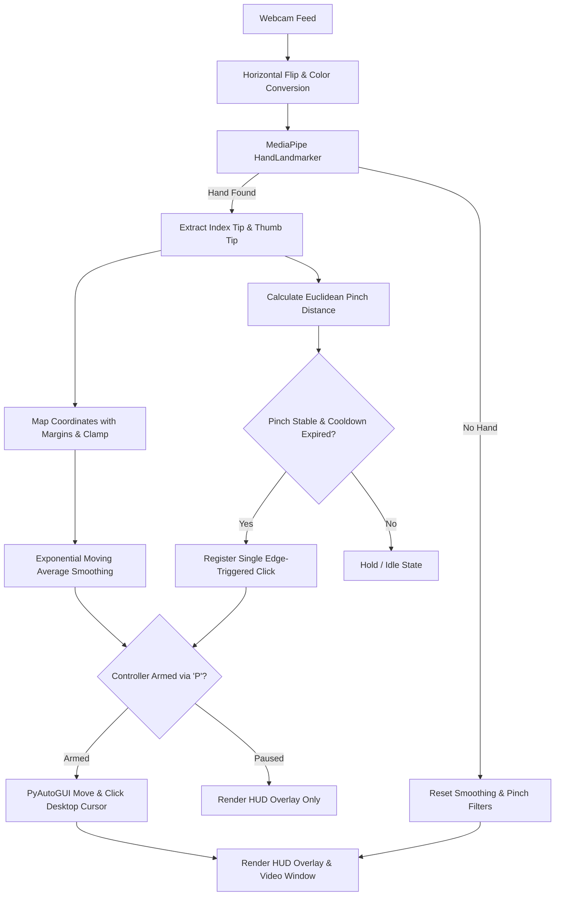

# AI-Based Hand Gesture Mouse Controller (Version 1.0)

A lightweight, robust, and beginner-friendly Python application that lets you control your laptop's mouse cursor using hand gestures captured by your built-in webcam.

Designed with an emphasis on **safety-by-default**, **privacy**, and **clean modular engineering**.

---

## Table of Contents

1. [Overview & Features](#overview--features)
2. [Limitations (Version 1.0)](#limitations-version-10)
3. [Architecture & Workflow](#architecture--workflow)
4. [Hardware & Software Requirements](#hardware--software-requirements)
5. [Installation on Windows](#installation-on-windows)
6. [MediaPipe Model Setup](#mediapipe-model-setup)
7. [Running the Application](#running-the-application)
8. [Keyboard Shortcuts & Controls](#keyboard-shortcuts--controls)
9. [Safety & Privacy Protections](#safety--privacy-protections)
10. [Automated Testing](#automated-testing)
11. [Troubleshooting](#troubleshooting)
12. [Future Improvements (Version 2.0 Roadmap)](#future-improvements-version-20-roadmap)

---

## Overview & Features

- **Real-Time Hand Tracking:** Powered by Google MediaPipe Tasks HandLandmarker detecting 21 3D hand landmarks in real time.
- **Natural Mirrored Cursor Movement:** Moving your hand to the right moves the cursor right, tracked accurately by your index fingertip.
- **Deadzone Anti-Jitter Filter:** Completely removes resting physiological hand tremor and camera noise when your hand is still.
- **Dual-Speed Adaptive Smoothing:** Silky-smooth damping for micro-targeting small buttons, fast dynamic response for large cross-screen sweeps with zero lag.
- **Click Anchor (Position Freeze):** Automatically locks cursor coordinates the instant a pinch is detected, preventing natural finger contraction from slipping the cursor off the target.
- **Scale-Adaptive Pinch Threshold:** Automatically normalizes pinch sensitivity against hand distance, ensuring identical responsiveness whether 1 foot or 3 feet away.
- **Dual Clicks:**
  - **Left Click:** Tap Thumb (ID 4) + Index (ID 8) together.
  - **Right Click:** Tap Thumb (ID 4) + Middle (ID 12) together.
- **Active Interaction Box:** Maps a comfortable sub-region of your webcam frame to your full screen so you don't need to stretch across the room to reach screen corners.
- **Disarmed-by-Default Safety:** Cursor control starts paused. Requires pressing `P` to arm.
- **Hardware Failsafe Integration:** PyAutoGUI failsafe remains enabled. Pushing the mouse into any corner auto-disarms the system.
- **Immediate Pause & Emergency Exit:** Press `P` to toggle pause/resume; press `Q` or `Esc` for clean shutdown.
- **100% Local & Private:** Processes all video frames on CPU memory. No images or logs are recorded or transmitted.

---

## Limitations (Version 1.0)

Version 1.0 intentionally avoids complexity to prioritize safety and reliability:
- Single hand detection only (`num_hands=1`).
- Left-click and right-click supported (no click-and-drag or scroll wheel).
- No keyboard emulation, volume control, or application launching.
- Requires standard indoor room lighting and an unobstructed webcam view.

---

## Architecture & Workflow



### Component Breakdown
- **`Config`**: Central dataclass containing all thresholds, margins, and paths.
- **`map_camera_to_screen` & `clamp_coordinates`**: Normalizes camera pixels to OS screen resolution with configurable margin boundaries.
- **`SmoothingFilter`**: Exponential Moving Average (EMA) smoother preventing jitter. Resets on tracking loss.
- **`PinchDetector`**: Edge-triggered debounced state machine preventing repeat clicks.
- **`MouseController`**: Wrapper over PyAutoGUI enforcing armed state, boundary clamping, and failsafe catching.
- **`HandDetector`**: MediaPipe Tasks HandLandmarker wrapper.
- **`draw_overlay`**: OpenCV HUD banner showing tracking status, armed state, and active interaction bounds.

---

## Hardware & Software Requirements

- **Operating System:** Windows 10 or Windows 11 (64-bit).
- **Webcam:** Built-in laptop webcam or standard USB webcam (720p or 1080p recommended).
- **Processor:** Any modern dual-core or quad-core CPU (Intel Core i3/i5/i7, AMD Ryzen, or equivalent).
- **Python Version:** Python 3.11, 3.12, or 3.13 (64-bit).

---

## Installation on Windows

### 1. Open PowerShell or Command Prompt
Navigate to your project directory:
```powershell
cd "a:\Python projects\hand-gesture-mouse-controller"
```

### 2. Verify Python Installation
```powershell
python --version
```
*(Ensure Python 3.11+ is displayed)*

### 3. Create and Activate a Virtual Environment
```powershell
# Create virtual environment
python -m venv .venv

# Activate virtual environment in PowerShell
.venv\Scripts\Activate.ps1

# Or activate in CMD
# .venv\Scripts\activate.bat
```

### 4. Install Verified Dependencies
```powershell
pip install --upgrade pip
pip install -r requirements.txt
```

---

## MediaPipe Model Setup

The hand tracking pipeline requires the official Google MediaPipe task model: `hand_landmarker.task`.

- **Automatic:** The project automatically downloads this file (~7.8 MB) on first launch if it is not present in `assets/`.
- **Pre-packaged:** A pre-downloaded copy is already placed in the `assets/` folder.
- **Manual Download (Air-gapped machines):** See [`assets/README.md`](assets/README.md) for direct download links.

---

## Running the Application

You can launch the application in **three easy ways**:

### Method 1: Desktop / Folder Shortcut (Recommended)
Double-click either of the custom-icon shortcuts located directly in the project folder:
- **`Start AI Gesture Mouse.lnk`**: One-click direct launch with custom glowing cyber-hand icon.
- **`AI Gesture Mouse Activator.lnk`**: Opens the sleek dark-mode desktop Activation Dashboard.

### Method 2: Batch Launcher
- Double-click **`Launch_Controller.bat`** (Auto-detects Python / `.venv` and runs `main.py`).
- Double-click **`Launch_Activator.bat`** (Opens the GUI Control Panel).

### Method 3: Command Line (PowerShell / Terminal)
```powershell
# Direct Controller
python main.py

# Or GUI Activation Panel
python activator.py
```

### Operational Steps:
1. The camera window titled **`AI Hand Gesture Mouse Controller v1.0 [EFFICIENCY & SMOOTH]`** will open.
2. The HUD at the top displays **`CONTROL: DISARMED / PAUSED`**. The cursor will **not** move yet.
3. Bring your hand into the frame. The indicator will change to **`TRACKING: HAND DETECTED`**.
4. Click on the video window to focus it.
5. Press the **`P`** key on your keyboard to **Arm** the controller. The HUD shifts to **`CONTROL: ARMED`**.
6. Point with your index finger inside the yellow boundary box to move the cursor.
7. **Left-Click:** Tap your thumb tip and index fingertip together (< 0.5s).
8. **Click & Drag:** Pinch and hold thumb + index (> 0.5s); open fingers to drop.
9. **Right-Click:** Tap your thumb tip and middle fingertip together.
10. **Scroll:** Raise index and middle fingers together and move hand up/down.
11. Press **`S`** to toggle between Standard and High (Low-Fatigue Wrist Mode).
12. Press **`P`** anytime to pause control, or **`Q`** / **`Esc`** to terminate cleanly.

---

## Keyboard Shortcuts & Controls

| Shortcut | Action | Description |
| :--- | :--- | :--- |
| **`P`** | **Arm / Pause Toggle** | Toggles mouse control between active and paused. |
| **`S`** | **Sensitivity Toggle** | Switches between Standard and High (Low-Fatigue Wrist Mode). |
| **`Q`** | **Emergency Exit** | Closes camera, frees resources, and exits program. |
| **`Esc`** | **Emergency Exit** | Alternative exit key matching standard desktop conventions. |
| **Corner Hit** | **Hardware Failsafe** | Moving the mouse pointer into any screen corner auto-disarms control. |

---

## Safety & Privacy Protections

See [`docs/safety_protocol.md`](docs/safety_protocol.md) for complete technical documentation.

- **Failsafe Always Active:** `pyautogui.FAILSAFE = True` is never disabled.
- **Fail-Closed on Lost Tracking:** Hand leaving frame instantly stops all mouse actions.
- **No Uncontrolled Threads:** Synchronous single-thread execution guarantees no rogue background control.
- **Zero Privacy Invasions:** 100% local processing; zero data uploaded or saved.

---

## Automated Testing

Run the included automated unit test suite without needing a camera or physical mouse:

```powershell
python -m unittest discover tests -v
```

All tests mock hardware interfaces to ensure zero disruption to your desktop during execution.

---

## Troubleshooting

See [`docs/troubleshooting.md`](docs/troubleshooting.md) for detailed solutions to:
- Camera permission denials on Windows.
- Multiple webcams or selecting camera index.
- Lighting and distance optimization.
- Adjusting smoothing factors and pinch thresholds.

---

## Future Improvements (Version 2.0 Roadmap)

Version 1.0 focuses strictly on rock-solid single-pointer control and left-clicks. Planned features for Version 2.0 include:
- Two-finger pinch for right-click.
- Index + Middle finger pinch-and-drag for drag-and-drop operations.
- Two-finger vertical swipe for page scrolling.
- Graphical configuration utility (slider UI for smoothing and margins).
- Multi-monitor coordinate mapping support.
